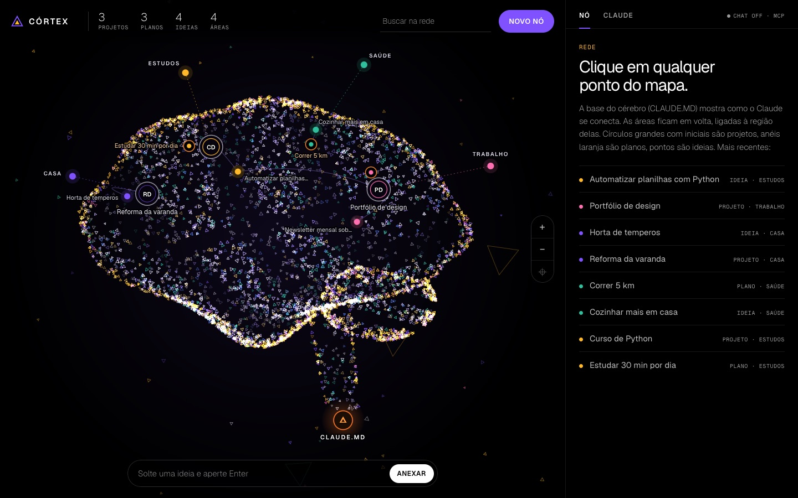
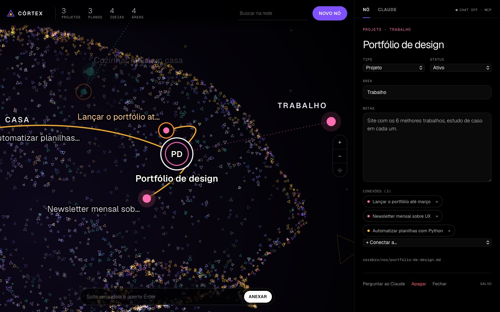
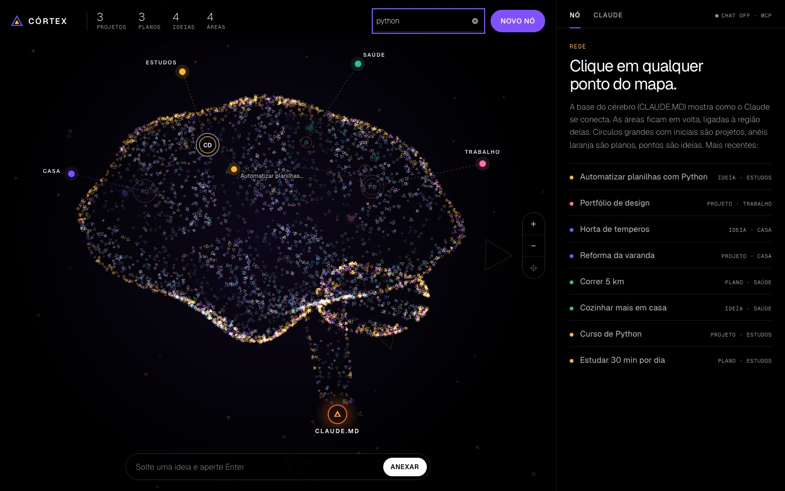
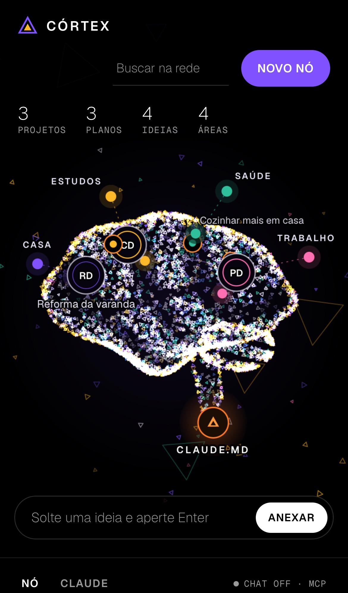

# Córtex

**Um segundo cérebro que roda no seu computador — e tem a forma de um cérebro.**

Ideias, planos e projetos viram pontos de luz na superfície de um cérebro animado. Tudo fica salvo como arquivos Markdown na sua máquina, e o Claude pode ler, organizar e criar anotações por você.



- **Local de verdade.** Roda em `http://localhost:3333`, só aceita conexões do seu próprio computador e não tem conta, nuvem nem banco de dados.
- **Seus arquivos, seu formato.** Cada anotação é um `.md` que você abre em qualquer editor.
- **Ligado ao Claude.** Conte uma ideia ao Claude Desktop ou ao Claude Code e ela aparece no mapa.
- **Zero dependências.** Só precisa do Node.js.

---

## Sumário

1. [Começar em 2 minutos](#1-começar-em-2-minutos)
2. [Como o Córtex organiza as coisas](#2-como-o-córtex-organiza-as-coisas)
3. [Usando o mapa](#3-usando-o-mapa)
4. [Usando com o Claude](#4-usando-com-o-claude)
5. [Editando os arquivos direto](#5-editando-os-arquivos-direto)
6. [Backup e histórico](#6-backup-e-histórico)
7. [Configuração](#7-configuração)
8. [Problemas comuns](#8-problemas-comuns)
9. [Privacidade](#9-privacidade)

---

## 1. Começar em 2 minutos

**Você precisa de:** [Node.js](https://nodejs.org) 18 ou mais novo. Confira com `node -v`. Funciona em macOS, Windows e Linux.

```bash
git clone https://github.com/andrecavalcantii/cortex.git
cd cortex
npm start
```

Abra **http://localhost:3333**.

Na primeira vez o cérebro aparece vazio. Escreva uma ideia na barra de baixo (*"Solte uma ideia e aperte Enter"*), aperte **Enter**, e ela surge no mapa. Pronto: você já está usando.

Para parar o Córtex, volte ao terminal e aperte `Ctrl + C`. Para abrir de novo, `npm start` na mesma pasta. Suas anotações continuam lá.

> **Dica:** copie `.env.example` para `.env` e preencha `CORTEX_DONO` com seu nome e `CORTEX_SOBRE` com uma linha sobre você. O Claude usa isso para saber com quem está falando. Tudo no `.env` é opcional.

---

## 2. Como o Córtex organiza as coisas

Cada anotação é um **nó**. Todo nó tem:

| Campo | O que é | Valores |
| --- | --- | --- |
| **Tipo** | O que a anotação representa | **Ideia** (algo solto), **Plano** (cronograma, meta, rotina) ou **Projeto** (algo que você está construindo) |
| **Área** | O grande tema da sua vida a que ela pertence | Livre: Trabalho, Estudos, Saúde, Casa… Ideias sem área vão para **Inbox** |
| **Status** | Em que pé está | **Semente**, **Ativo**, **Pausado** ou **Feito** |
| **Notas** | O texto da anotação | Markdown livre |
| **Conexões** | Outros nós relacionados | Sempre nos dois sentidos: se A liga B, B liga A |

### Lendo o mapa

| No mapa | Significa |
| --- | --- |
| Círculo grande com iniciais | **Projeto** |
| Anel laranja com miolo colorido | **Plano** |
| Ponto colorido | **Ideia** |
| Anel com nome, fora do cérebro | **Área**, ligada por uma linha pontilhada à região onde ficam os nós dela |
| A cor de um nó | A cor da área dele |
| Linha violeta entre nós | Uma **conexão** (fica âmbar quando um dos dois está selecionado) |
| Triângulo laranja na base do tronco | O **CLAUDE.MD**, o índice que o Claude lê |

O status também aparece no desenho:

| Status | Projeto | Plano | Ideia |
| --- | --- | --- | --- |
| Semente / Ativo | Normal | Normal | Ponto cheio |
| Pausado | Anel interno mais fino | — | Ponto apagado |
| Feito | Ganha um ponto verde no alto | Miolo fica verde | Vira um anel vazio |

---

## 3. Usando o mapa

### Capturar uma ideia rápida

Escreva na barra de baixo e aperte **Enter**. A ideia é criada na **Inbox**, com as primeiras palavras como título (e o texto inteiro nas notas, se for longo). Depois você abre e organiza.

Com o chat da API ligado ([seção 4](#b-chat-dentro-da-página-com-chave-da-api)), aparece a opção **"Claude organiza e conecta"**: o Claude escolhe o título, o tipo e a área, e já conecta a nós parecidos.

### Criar um nó

Clique em **Novo nó** (no alto, à direita). Ele cria uma *"Nova ideia"* — dentro da área que estiver selecionada, ou na Inbox — e deixa o título pronto para você digitar por cima.

### Abrir e editar



Clique em qualquer ícone do mapa. A câmera **aproxima e centraliza** nele, e o painel da direita mostra o nó para edição:

- **Título**: clique e escreva.
- **Tipo** e **Status**: escolha nas listas.
- **Área**: escolha uma existente ou digite um nome novo (isso cria a área).
- **Notas**: texto livre em Markdown.

**Não existe botão de salvar.** Tudo é salvo sozinho meio segundo depois que você para de digitar; o canto do painel mostra *Salvando…* e depois *Salvo*.

O caminho do arquivo aparece no fim do painel (por exemplo `cerebro/nos/portfolio-de-design.md`).

### Conectar nós

No painel do nó, em **Conexões**, use **+ Conectar a…** e escolha o outro nó. Para desfazer, clique no **×** da conexão. Clicar no nome de uma conexão leva o mapa até ela.

Quando um nó está selecionado, o mapa destaca ele e as conexões dele, e apaga o resto.

### Apagar

Clique em **Apagar** e depois **clique de novo** em até 3 segundos (o botão pede confirmação). O nó sai do mapa, o arquivo é apagado e as conexões com ele somem dos outros nós. Se o [backup](#6-backup-e-histórico) estiver ligado, dá para recuperar pelo histórico.

### Áreas

Clique no anel de uma área (fora do cérebro) para ver todos os nós dela, com a contagem de projetos, planos e ideias, e o botão **Nova ideia nesta área**.

Para **renomear** ou **juntar** áreas, mude o campo *Área* dos nós: a área existe enquanto algum nó usar aquele nome.

### Buscar



Digite em **Buscar na rede**. Os nós cujo título, área ou notas contêm o texto ficam acesos, e o resto escurece. Apague o texto para voltar ao normal.

### Navegar

| Para… | Mouse / trackpad | Celular | Teclado |
| --- | --- | --- | --- |
| Aproximar ou afastar | Roda do mouse, pinça no trackpad, ou botões **+ −** | Pinça | `+` e `-` |
| Mover o mapa | Arrastar o fundo | Arrastar | — |
| Aproximar num ponto | Duplo clique no vazio | — | — |
| Voltar ao enquadramento inicial | Botão **⌖** | — | `0` |
| Ir até um nó | Clique no ícone ou num nome do painel | Toque | — |
| Fechar o nó aberto | **Fechar** no painel | **Fechar** | `Esc` |

O cérebro balança devagar enquanto você olha; ele para quando o ponteiro está sobre um ícone ou quando há algo selecionado, para nada fugir do clique. Nomes que não cabem sem cobrir outros ficam escondidos e aparecem ao passar o mouse ou ao aproximar.

### Em janela estreita



Com a janela estreita, o painel vai para baixo do mapa. Em telas de toque, os botões de zoom somem e o zoom é por pinça.

O Córtex **não abre em outros aparelhos**, nem no celular na mesma rede Wi-Fi: o servidor só aceita conexões do próprio computador (veja [Privacidade](#9-privacidade)).

### Quem pediu menos movimento

Se o seu sistema está com *reduzir movimento* ligado, o cérebro aparece parado e já montado, e a câmera vai direto ao destino em vez de viajar até ele.

---

## 4. Usando com o Claude

São três jeitos, e dá para usar todos ao mesmo tempo. O **A** é o recomendado: não precisa de chave de API.

### A. Claude Desktop e Claude Code (MCP)

Na pasta do Córtex, rode uma vez:

```bash
npm run setup-claude
```

Esse comando:

1. adiciona o Córtex ao arquivo de configuração do Claude Desktop, guardando uma cópia do antigo em `.bak`;
2. se o Claude Code estiver instalado, registra o Córtex nele para **todas as pastas**.

Depois **feche o Claude Desktop por completo** (no Mac, `Cmd + Q`; no Windows, botão direito no ícone perto do relógio → *Sair*) e abra de novo. No Claude Code, comece uma conversa nova.

**Para conferir:** peça *"lista os nós do meu Córtex"*. No Claude Code, `claude mcp get cortex` deve mostrar *Connected*.

O servidor do Córtex (`npm start`) **não precisa estar rodando** para o Claude ler e escrever: ele mexe direto nos arquivos. Se o mapa estiver aberto, ele atualiza sozinho.

#### O que pedir

| Você diz | O Claude faz |
| --- | --- |
| *"Tive uma ideia: um app que lembra de regar as plantas"* | Procura algo parecido, cria a ideia na área certa e conecta ao que for relacionado |
| *"Lê meu Córtex e me diz o que priorizar essa semana"* | Lê a rede inteira e responde com base nela |
| *"Transforma a ideia da horta num plano de 4 semanas"* | Cria um plano com entregas semanais e conecta à ideia |
| *"O que eu tenho sobre Python?"* | Busca em títulos, áreas e notas |
| *"Marca o curso de Python como feito"* | Muda o status do nó |
| *"Conecta o portfólio à newsletter"* | Liga os dois nós |

As ferramentas que o Claude ganha são `listar_nos`, `ler_no`, `buscar`, `criar_no`, `atualizar_no` e `conectar_nos`. **Ele não consegue apagar nós** — apagar é só pelo mapa, de propósito.

<details>
<summary><b>Configurar à mão</b> (se o comando não funcionar)</summary>

No Claude Desktop, abra *Configurações → Desenvolvedor → Editar configuração* e acrescente ao `claude_desktop_config.json`:

```json
{
  "mcpServers": {
    "cortex": {
      "command": "/caminho/completo/para/node",
      "args": ["/caminho/completo/para/cortex/mcp.js"]
    }
  }
}
```

Use o caminho completo do Node (`which node` no Mac/Linux, `where node` no Windows): o Claude Desktop nem sempre enxerga o mesmo `PATH` do terminal.

No Claude Code:

```bash
claude mcp add --scope user cortex -- node /caminho/completo/para/cortex/mcp.js
```

</details>

### B. Chat dentro da página (com chave da API)

1. Crie uma chave em [console.anthropic.com](https://console.anthropic.com). A API é cobrada à parte do plano do claude.ai.
2. No `.env`, preencha `ANTHROPIC_API_KEY=sk-ant-...`.
3. Reinicie o Córtex (`Ctrl + C` e `npm start`).

Isso liga:

- a aba **Claude** do painel, um chat que lê a rede e cria, edita e conecta nós (cada mudança aparece como um aviso verde na conversa);
- o botão **Perguntar ao Claude** de cada nó, que abre o chat já falando daquele nó;
- a opção **"Claude organiza e conecta"** na barra de captura.

O canto do painel mostra **Claude on** quando a chave está funcionando.

### C. Abrir a pasta no Claude Code

```bash
cd cortex/cerebro
claude
```

O Claude Code lê o `CLAUDE.md` sozinho e entende o formato dos arquivos. Bom para reorganizações grandes, como *"junta as áreas Faculdade e Estudos"*.

---

## 5. Editando os arquivos direto

Cada nó é um arquivo em `cerebro/nos/`. Você pode criar, editar e apagar esses arquivos em qualquer editor — **o mapa aberto atualiza sozinho** em menos de um segundo.

```markdown
---
title: Portfólio de design
type: projeto          # ideia | plano | projeto
area: Trabalho
status: ativo          # semente | ativo | pausado | feito
links: [lancar-o-portfolio-ate-marco, newsletter-mensal-sobre-ux]
created: 2026-01-10T12:00:00.000Z
updated: 2026-01-10T12:00:00.000Z
---

Site com os 6 melhores trabalhos, estudo de caso em cada um.
```

Coisas para saber:

- **O nome do arquivo é o id do nó**, gerado a partir do título na criação (`Portfólio de design` → `portfolio-de-design.md`). Mudar o título depois não renomeia o arquivo.
- **`links` usa ids**, não títulos. Se editar à mão, coloque o link nos dois arquivos para a conexão valer nos dois sentidos.
- **`cerebro/CLAUDE.md` é gerado sozinho** a cada mudança, com o índice de toda a rede. Não edite esse arquivo; edite os nós.

---

## 6. Backup e histórico

As suas anotações **nunca vão para o repositório do Córtex**: a pasta `cerebro/` está no `.gitignore`. Para ter histórico e uma cópia fora do computador, ligue o backup automático com Git:

1. Instale o [Git](https://git-scm.com/downloads), se ainda não tiver.
2. No GitHub, crie um repositório **privado** e **vazio** (sem README), por exemplo `cortex-cerebro`.
3. Na pasta do Córtex:
   ```bash
   npm run backup -- https://github.com/SEU_USUARIO/cortex-cerebro.git
   ```
   Na primeira vez, o Git pode abrir uma janela de login do GitHub.
4. Reinicie o Córtex (`Ctrl + C` e `npm start`). Ao subir, ele mostra `Backup Git: ativo → …`.

A partir daí, **uns 20 segundos depois de cada mudança**, o Córtex faz um commit da pasta `cerebro/` e envia ao GitHub. Ao fechar com `Ctrl + C`, ele salva o que estiver pendente. Clique no **CLAUDE.MD** do mapa para ver o horário do último backup e, se houver, o último erro.

Prefere só histórico, sem GitHub? Rode `npm run backup` sem a URL: os commits ficam só no computador.

**Recuperar algo apagado ou uma versão antiga:**

```bash
cd cerebro
git log --oneline -- nos/portfolio-de-design.md    # versões desse nó
git checkout <commit> -- nos/portfolio-de-design.md
```

---

## 7. Configuração

Tudo fica no arquivo `.env`, na pasta do Córtex (copie de `.env.example`). Mudou algo? Reinicie com `Ctrl + C` e `npm start`.

| Variável | Para quê | Padrão |
| --- | --- | --- |
| `CORTEX_DONO` | Seu nome, para o Claude | vazio (texto neutro) |
| `CORTEX_SOBRE` | Uma linha sobre você, para o Claude | vazio |
| `ANTHROPIC_API_KEY` | Liga o chat dentro da página | desligado |
| `CLAUDE_MODEL` | Modelo usado pelo chat da página | `claude-sonnet-5-5` |
| `PORT` | Porta do mapa | `3333` |
| `CORTEX_DIR` | Guardar as anotações em outra pasta | `./cerebro` |

`CORTEX_DIR` serve, por exemplo, para manter as anotações numa pasta sincronizada (Dropbox, iCloud) ou ter dois cérebros separados, cada um com seu `.env`.

---

## 8. Problemas comuns

**`npm start` para com o erro `EADDRINUSE`.**
A porta 3333 já está em uso por outro programa (ou por outro Córtex aberto). Feche-o, ou use outra porta: `PORT=4000` no `.env`.

**O mapa mostra "Servidor offline".**
O terminal onde o Córtex rodava foi fechado. Rode `npm start` de novo e recarregue a página.

**O Claude não vê o Córtex.**
1. Feche o Claude Desktop por completo e abra de novo; no Claude Code, comece uma conversa nova.
2. Rode `claude mcp get cortex` e veja se está *Connected*.
3. Se você trocou a versão do Node (por exemplo com `nvm`), o caminho salvo ficou velho: rode `npm run setup-claude` de novo.
4. Mudou a pasta do Córtex de lugar? Mesmo caso: `npm run setup-claude` de novo.

**No Mac, o Claude não consegue ler a pasta.**
Se o Córtex está em *Downloads*, *Documentos* ou *Mesa*, o macOS pode pedir permissão na primeira vez. Aceite, ou libere em *Ajustes do Sistema → Privacidade e Segurança → Arquivos e Pastas*. Outra saída é guardar o Córtex fora dessas pastas.

**A aba Claude diz que o chat está desligado.**
Falta a `ANTHROPIC_API_KEY` no `.env`, ou o Córtex não foi reiniciado depois de preenchê-la. Esse chat é opcional: o jeito [A](#a-claude-desktop-e-claude-code-mcp) funciona sem chave.

**O backup não está enviando.**
Clique no **CLAUDE.MD** do mapa: o último erro aparece ali. O mais comum é falta de login no GitHub — rode `git push` dentro de `cerebro/` uma vez, faça o login, e reinicie o Córtex.

**Quero começar do zero.**
Apague (ou mova) a pasta `cerebro/`. Ela é recriada vazia no próximo `npm start`.

---

## 9. Privacidade

- O servidor só escuta em `127.0.0.1`: **nenhum outro aparelho da rede** consegue abrir o seu Córtex.
- As anotações ficam em arquivos na sua máquina e **não entram** neste repositório.
- Saem do computador apenas:
  - o que você mandar ao Claude (pelo MCP, o Claude lê os nós que precisar; pelo chat da página, um resumo da rede vai junto de cada mensagem);
  - o backup, se você ligar, para o repositório que você escolher;
  - as fontes da página, carregadas do Google Fonts.

---

## Licença

[MIT](LICENSE) — use, modifique e distribua à vontade.
